<p align="center">
  
</p>

<p align="center">
  <b>Turn Claude Code, Codex, Cursor, OpenCode and Gemini CLI into a careful senior AI agent engineer.</b><br>
</p>


<p align="center">
  
  
  
  
  
</p>

<br>

---

# agent-engineer

### Turn your coding agent into a Senior AI Engineer

- agent-engineer is a free and fully open-source plugin. It works on Claude Code, Codex CLI, Cursor, OpenCode and Gemini CLI.

- It contains 11 skills, 4 subagents and 5 hooks. The skills carry agent-engineering knowledge (tools, prompting, context, RAG, evals, tracing, guardrails, production).

- In a blinded A/B test on 6 agent tasks, Claude Code (Opus 5.5) met 53% of requirements with the plugin vs 34% without.

- The plugin does not touch or collect any of your data or code. It doesn’t collect any analytics, etc. either. It’s fully open source, there’s no backend.

## Performance

We gave Claude Code (Opus 5.5) six agent-engineering tasks, with and without the plugin, three runs each. Every result was graded **blind** against a checklist written before any run.

| Comparison | Plugin | No plugin | Difference (95% CI) |
|---|:---:|:---:|:---:|
| **All 6 tasks** (18 runs per arm) | **53%** | 34% | **+19 points** (+14 to +25) |
| 4 tuning tasks | 49% | 25% | +24 (+16 to +31) |
| **2 held-out tasks** | 62% | 52% | **+10** (+2 to +19) |

---

## Install

```bash
git clone https://github.com/sarthakrastogi/agent-engineer.git ~/agent-engineer
```

| Tool | How |
|---|---|
| **Claude Code** | `/plugin marketplace add ~/agent-engineer` then `/plugin install agent-engineer@agent-engineer` |
| **Codex CLI** | `cd your-project && ~/agent-engineer/install.sh --harness codex`, then approve the hooks in `/hooks` |
| **Cursor** | Install the plugin from GitHub, or `~/agent-engineer/install.sh --harness cursor` |
| **OpenCode** | `cd your-project && ~/agent-engineer/install.sh --harness opencode` |
| **Gemini CLI** | `cd your-project && ~/agent-engineer/install.sh --harness gemini` |
| **Skills only, any tool** | `npx skills add sarthakrastogi/agent-engineer` |

---

## How your coding assistant uses it

There are no special commands. Say what you'd normally say, and the router skill picks the stage.

| You say | What loads | What it pushes the assistant to do |
|---|---|---|
| "Our bot invents order numbers" | `agent-accuracy` | Read logs, find the missing data source, fix in code, add a regression check, measure |
| "Add a tool that issues refunds" | `agent-guardrails` + `agent-tools` | Amount caps, ownership checks, idempotency, injection-aware design, guard tests |
| "Make the prompt friendlier. Is it better?" | `agent-prompting` + `agent-evals` | Make the change, then run the eval or say plainly it's unevaluated |
| "Switch to a cheaper model" | `agent-production` | Model as config, an eval comparison as the gate, a cost estimate |
| "Add tracing" | `agent-observability` | OTel GenAI spans per LLM and tool call, token usage, correlation IDs, PII handling |
| "Build an agent that answers from these docs" | `agent-design` + `agent-rag` | Simplest shape that fits, citations, abstention, an eval set |

To call a skill directly: `/agent-engineer:agent-evals` in Claude Code, `$agent-evals` in Codex.

---

## What's inside

### 11 skills

| Skill | Use it for |
|---|---|
| **`agent-engineer`** | **Start here.** Router: stack diagnosis, blank-page projects, broad requests, "we launch next week" |
| `agent-design` | Success criteria, the simplest shape (single call → workflow → agent → multi-agent), framework and model choice |
| `agent-tools` | Tool, function-calling and MCP server design |
| `agent-prompting` | System prompts, examples, structured output, model quirks |
| `agent-context` | Long runs: memory, compaction, caching, context rot |
| `agent-rag` | Whether you need retrieval at all; parsing, chunking, hybrid search, reranking, retrieval evals |
| `agent-evals` | Error analysis, datasets, validated LLM judges, trajectory evals, CI gates |
| `agent-observability` | OTel/OpenInference tracing, metrics, feedback, PII |
| `agent-accuracy` | The debugging loop: reproduce, localise, least powerful fix, measure, log |
| `agent-guardrails` | Prompt injection, the lethal trifecta, permissions, approvals, red-teaming |
| `agent-production` | Reliability, cost and latency, CI/CD, rollouts, model migration |

### 4 subagents

Isolated workers for jobs that would flood your main context. Each preloads the skill whose method it follows.

| Subagent | Job |
|---|---|
| `trace-analyst` | Reads 50 to 100 real traces and builds a failure taxonomy with counts |
| `eval-engineer` | Builds datasets and judges, then validates the judges against human labels |
| `rag-diagnostician` | Walks failing questions through the RAG pipeline to find where the answer was lost |
| `agent-reviewer` | Pre-release review of prompts, tools, loop, security and observability |

### 5 hooks

| Hook | What it does |
|---|---|
| **Session-start profile** | Lists the LLM frameworks found (manifests, or imports if there's no manifest) and whether tracing and evals exist |
| **Skill hint** | In an LLM project, names the skill a request needs ("add a refund tool" → guardrails + tools), so imperative tasks get the checks too |
| **Secret guard** | Blocks API keys being written into source files |
| **Behaviour-change reminder** | Says once that a changed prompt or tool needs an eval run. Reads the lines around an edit, so a one-word prompt change counts |
| **Eval gate** | Fires once per session, before the agent finishes, if behaviour changed and no eval command ran |


### The agent stack: fix failures at the lowest layer that explains them

```text
   symptom                               layer       skills that handle it
   ──────────────────────────────────────────────────────────────────────────
   roles collide, handoffs lose work     GRAPH   ──► agent-design
   runs forever / stops early            LOOP    ──► agent-design, agent-production
   unsafe actions, lost state            HARNESS ──► agent-tools, agent-guardrails
   didn't see the right facts            CONTEXT ──► agent-context, agent-rag
   right facts, wrong output             PROMPT  ──► agent-prompting

        add a layer only when evidence shows the simpler one fails
```


---

## Contributing

**Try it on a real agent repo** and tell me where it misfires. [Open an issue](https://github.com/sarthakrastogi/agent-engineer/issues).

If you build agents for a living, the lesson worth keeping even without the plugin: **a change isn't better until it's been measured**, and the cheapest place to enforce that is the moment your coding assistant says "done."

You can also [DM me on LinkedIn 💭](https://www.linkedin.com/in/sarthakrastogi/) to discuss any issues.

<br>

<p align="center">
  If agent-engineer saves you time building AI agents, consider giving it a ⭐<br>
</p>